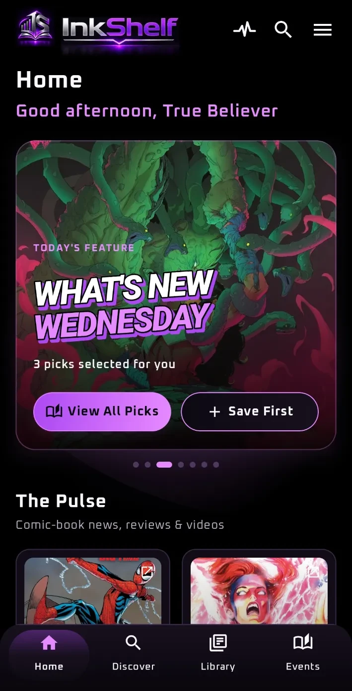
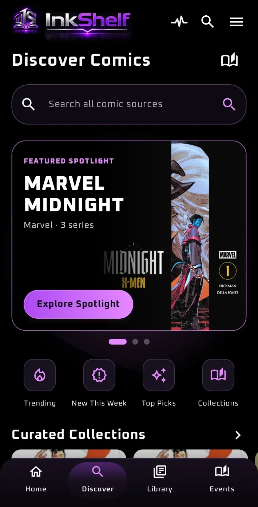
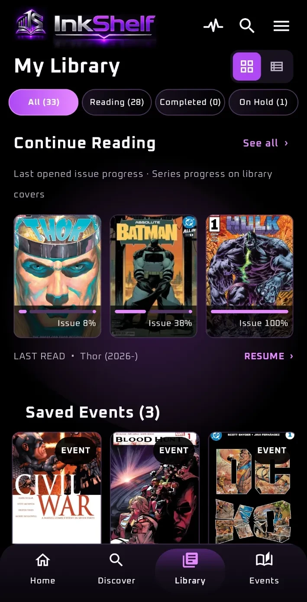
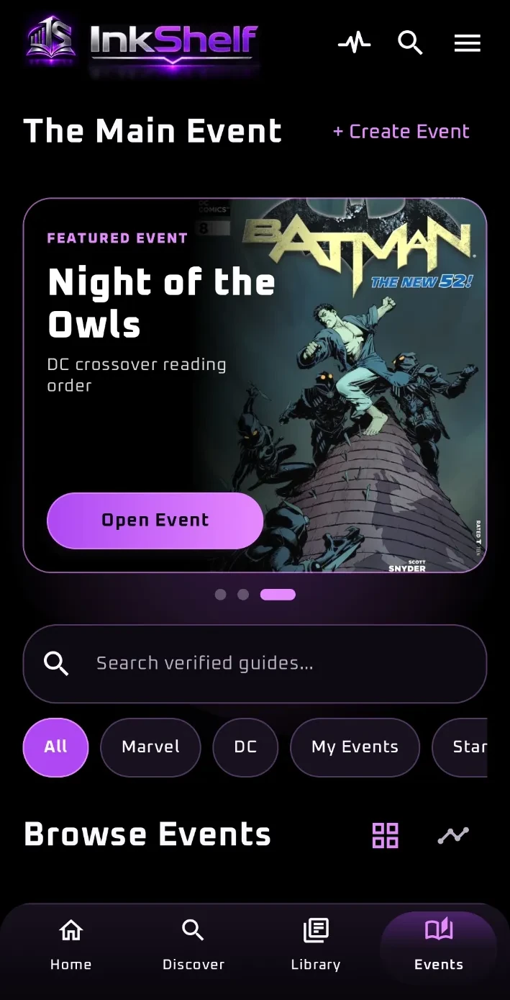
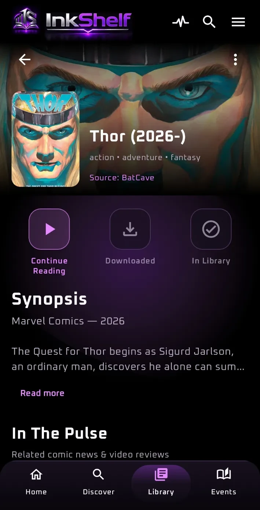
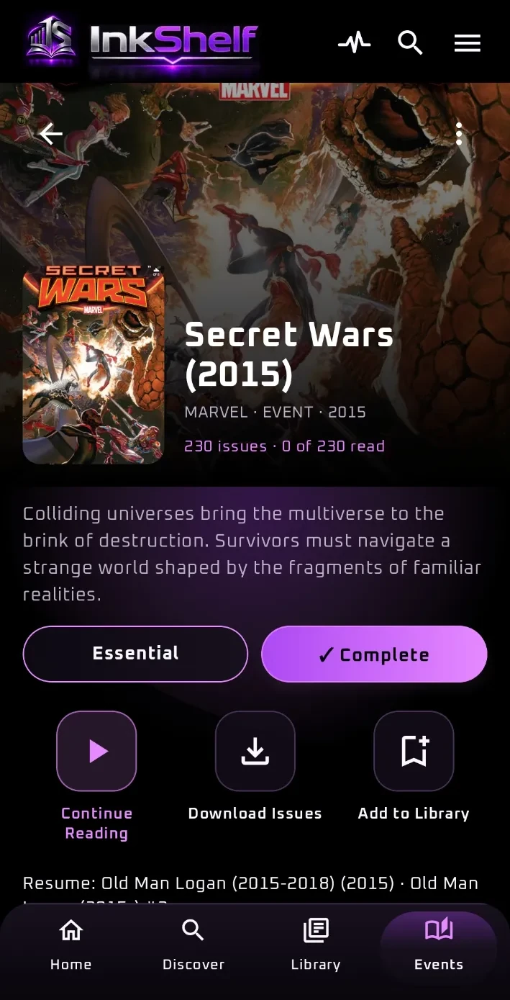
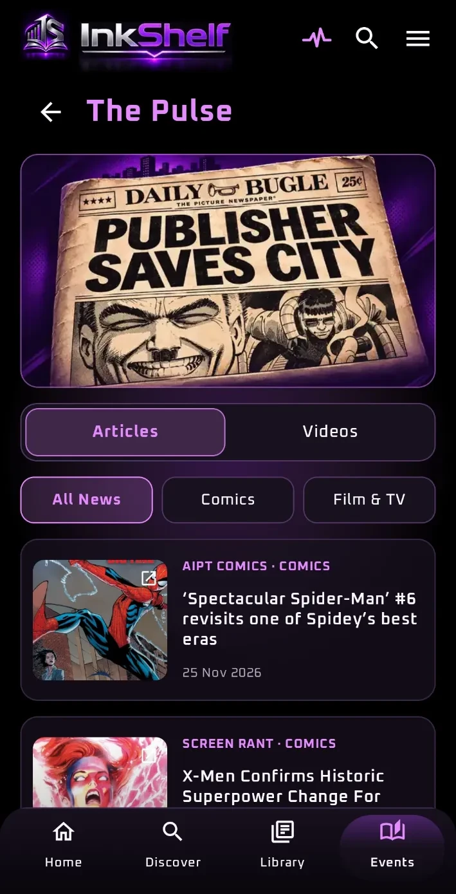

# ARC — Archive. Read. Collect.
[](https://github.com/Rainkingx/InkShelf/releases)

**ARC (formerly InkShelf)** is an Android comic and manga reader built as a custom fork of [TachiyomiJ2K](https://github.com/Jays2Kings/tachiyomiJ2K).

The project keeps the proven J2K reader, library, source/extension, download, backup and tracking foundations while building a more comic-focused ARC experience on top.

> ARC is under active development. Some features are intentionally marked **BETA**.

## Features

ARC introduces a rebuilt Android interface with a shared header, bottom navigation and a comic-focused visual identity, while retaining the existing reader and library foundations.

- **Home:** daily themed picks, continue reading and personalised discovery.
- **Discover:** editorial spotlights, curated collections, new releases, recommendations and multi-source search.
- **Library:** saved comics, reading history and saved events.
- **Events:** curated crossover reading orders, Essential and Complete modes, and custom events with editable issue order and artwork.
- **The Pulse:** comic news, reviews and videos, linked to their original publishers.
- **Comic details:** issue covers, reading and download controls, related comics and source information.
- **Appearance:** selectable colour themes, limited-event themes and customisable cinematic startup.
- **Reader:** multiple reading modes and optional on-device Panel Flow (beta).
- **Setup:** optional metadata enrichment through Metron and guided source installation.
- **Offline reading:** downloads, local comic import, backup and restore.

## Installation and updates

The existing Android application ID, signing identity and update asset name remain unchanged for in-place upgrades. The public APK is available from [GitHub Releases](https://github.com/Rainkingx/InkShelf/releases). Check the release notes for the current stable version and any available prereleases.

Before switching from an existing installation, export a backup. Development builds and public releases use different Android package IDs; a development APK cannot be upgraded in place by the public APK. Restore a backup in the new installation and check your library before removing the old app. Downloaded files and extension settings may need separate migration.

Only install extensions you trust and use sources for which you have lawful access. Extensions are separate Android packages and are not bundled with the APK.

## Panel Flow &mdash; BETA

Panel Flow is an optional guided-reading mode designed primarily for Western left-to-right comics.

It uses bundled **on-device text recognition** to find dialogue and guide the reader through a page. Detection is not perfect, which is why the feature remains marked **BETA**.

Panel Flow does not require a cloud OCR service.

## Privacy

ARC does not include the upstream TachiyomiJ2K Firebase configuration.

The current project does not include Firebase Analytics or Firebase Crashlytics. Panel Flow text recognition runs on-device.

## Content and sources

ARC does **not** host, provide or distribute copyrighted comic or manga content.

Sources/extensions are separate from the app. Requests or problems relating to third-party sources should be handled by the relevant extension/source project rather than this repository.

## Building

### Requirements

- JDK 21
- Android SDK / Android Studio
- Git

### Windows

```powershell
git clone https://github.com/Rainkingx/InkShelf.git
cd InkShelf

$env:JAVA_HOME="PATH_TO_JDK_21"
.\gradlew.bat :app:assembleDevDebug -x :app:formatKotlinMain
```

### Linux / macOS

```bash
git clone <your-repository-url>
cd InkShelf

./gradlew :app:assembleDevDebug -x :app:formatKotlinMain
```

Debug APKs are produced under:

```text
app/build/outputs/apk/
```

## Contributing

Bug reports and focused improvements are welcome. Please read [`.github/CONTRIBUTING.md`](.github/CONTRIBUTING.md) before opening an issue.

For ARC-specific bugs, include:

- ARC version/build
- Android version
- device/model
- clear reproduction steps
- screenshots or logs where useful

## Upstream and attribution

ARC is a derivative work based on **TachiyomiJ2K** by Jays2Kings, which itself descends from the original **Tachiyomi** project by Javier Tomás and contributors.

The wider Tachiyomi ecosystem is now continued by projects including [Mihon](https://github.com/mihonapp/mihon).

ARC retains upstream copyright, licence and attribution notices as required.

## Licence

Licensed under the **Apache License 2.0**. See [LICENSE](LICENSE).

## Disclaimer

ARC is not affiliated with or endorsed by content providers, publishers, TachiyomiJ2K, Mihon, or third-party extension developers.

Users are responsible for complying with the laws and terms applicable to the content and sources they choose to access.

<!-- INKSHELF_SCREENSHOTS_START -->
## Screenshots

<table>
  <tr>
    <td align="center"><br><b>Home</b></td>
    <td align="center"><br><b>Discover</b></td>
  </tr>
  <tr>
    <td align="center"><br><b>Library</b></td>
    <td align="center"><br><b>Events</b></td>
  </tr>
  <tr>
    <td align="center"><br><b>Comic details</b></td>
    <td align="center"><br><b>Event details</b></td>
  </tr>
  <tr>
    <td align="center"><br><b>The Pulse</b></td>
    <td align="center"><br><b>Issues and recommendations</b></td>
  </tr>
</table>

Screenshots show the earlier interface and may still display the previous InkShelf branding. Comic artwork and publisher branding belong to their respective rights holders.
<!-- INKSHELF_SCREENSHOTS_END -->
